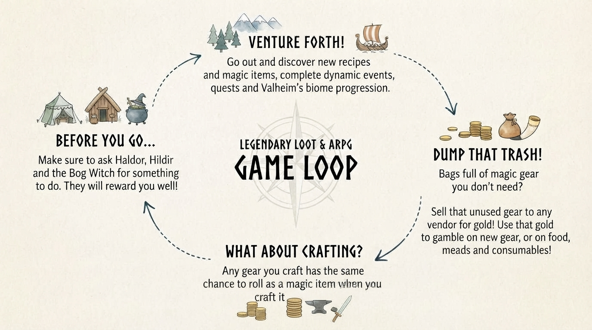
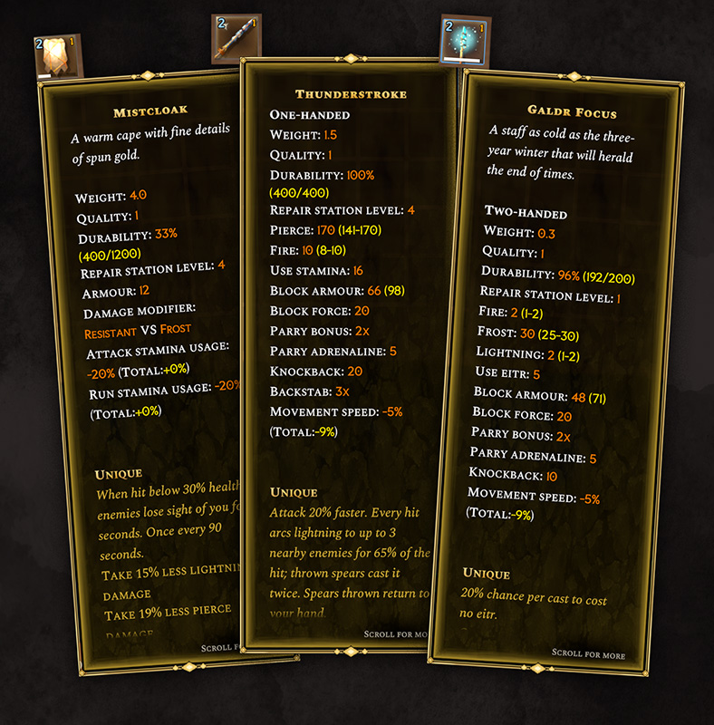
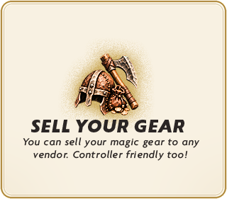
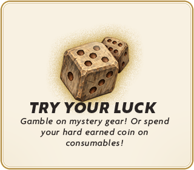
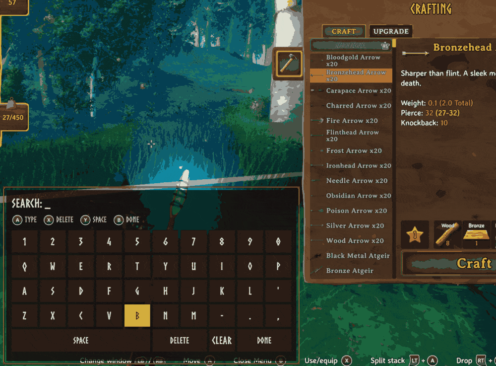

# Legendary Loot and ARPG

A Diablo-style ARPG overhaul for Valheim, in four parts: affix loot, vendors and bounties, enemy scaling, and world
events. Controller friendly: every effect is a passive or a proc, with no extra keybinds. Multiplayer: required on
the server and every client; the server's settings and data files are synced to all players.

**This is a beta (0.0.x).** Expect balance changes; your feedback shapes them.

## Loot

Enemies drop weapons, armor and trinkets with random affixes in six tiers:

| Tier | Color | Affixes |
| --- | --- | --- |
| Uncommon | Green | 1 |
| Magic | Blue | 2 |
| Rare | Yellow | 3 |
| Epic | Purple | 4 |
| Legendary | Orange | 4 (highest values) |
| Unique | Gold | 1 named power + 4 at Legendary values |

- Every drop shows a beam of light in its tier color. Crafted gear rolls too. Loot is personal for a while, so friends
  don't snatch each other's drops.
- Over 50 Uniques with named powers (Windforce, Thunderstroke, the One-Eyed King and more), each limited to the items
  it suits.
- Tier odds rise with the biome and with the stars of what you kill.

## Vendors, gold and bounties

 

- Sell gear to Haldor, Hildir and the Bog Witch for gold. Each sells gear of its own types (from the biomes you've
  reached and recipes you know): daily specials, a once-a-day Mystery item, a reroll, and a Unique gamble.
- A **Quests** tab at each vendor: Haldor's bounties (hunts and camps in Normal, Hard and Very Hard), Hildir's delves
  (find a glowing chest deep in a dungeon; cleared dungeons fill back up) and the Bog Witch's trophy turn-ins.
- Two buildable vendor stalls: Boogie's Bar (meads and dishes) and Grillo's General Store (arrows, bolts, bombs).

## Enemy scaling

- Creatures roll 0-5 stars (capped by biome), growing tougher and larger, and get affixes from their stars on:
  effects like Quick, Armored, Rending, Leeching or Splitting, and elemental infusions with a ground aura.
- **Unique enemies**: rare gold, liquid-metal elites with a boss affix (Reflective, Mending, Summoner, Elementalist,
  Enraged, Twin, Black Hole). One appears every 20-40 minutes you spend outside bases, and 1-3 guard each dungeon.
  Better loot.
- **Bosses** get a boss affix plus one affix per star, a little more health and damage per star, and their health in
  numbers on the boss bar.
- More health for each extra player nearby (config).

## Night

From dusk to dawn the creatures of Valheim grow stronger: 30% more damage and health. Their gear drops are better too:
higher tiers and Unique items are more likely.

## World events

Blue circles appear on the map near each player; you find out what each is when you walk in. A countdown on the map
shows when the next ones appear.

- **Horde**: survive three waves. **Champion Hunt**: slay a unique enemy and its escorts. **Ambush**: it springs when
  you step in.
- **Shrine**: touch it for 5 minutes of Fury, Swiftness or Fortune.
- **Defend**: keep the Shrine of Protection alive through three waves of raiders.
- **Boss** (rare): a weaker copy of a boss, with a rich reward chest.
- Everyone who takes part gets their own reward chest, marked with a pulsing ping on their map until it's emptied.
- **Hunted**: away from your base, something may come looking for you: a pack of the biome's creatures, or a lone
  **Apex Predator** (two stars stronger, with much better odds of a Unique). Kill them all for a reward chest. No map
  circle, no timer: you won't see it coming.

## Also

- Recipe search above the crafting list. With a controller, press the right stick to type: Steam's keyboard in Big
  Picture / SteamOS, the mod's own on-screen keyboard elsewhere.

## Installing

Install with r2modman or Thunderstore Mod Manager, or copy `LegendaryLootARPG.dll` into `BepInEx/plugins/`.

## Configuration

- `BepInEx/config/BhimaJenkins.LegendaryLootARPG.cfg`: drop chance, Unique chance, drops from the next biome (off by
  default: gear stays in its biome), weapon/armor split, personal loot, light shafts, visuals, quests reset, enemy
  count (1x-3x), enemy multiplayer health and more.
- `BepInEx/config/LegendaryLootARPG/`: the data files. Edit one on the server and it reloads straight away for everyone.
  - `affixes.yml`, `uniques.yml`, `powers.yml`: every affix and Unique, where they roll and their values.
  - `loot.yml`: drop chances, tier odds by biome, creature and material biomes, and Eitr for the early feasts.
  - `vendors.yml`: prices, what each vendor sells, and the stalls.
  - `quests.yml`: bounties, delves and trophy quests.
  - `enemies.yml`: stars, enemy affixes, unique enemies and bosses.
  - `events.yml`: world events, their creatures and rewards.

A data file you haven't edited updates itself when the mod updates; one you've edited is left alone, so copy new
sections in from the defaults yourself.

### Modded weapons and magic schools

The early feasts (Meadows through Plains, and Sailor's Bounty) give some Eitr, so magic gear from other mods is usable
before the Mistlands. Change or remove them under `feastEitr` in `loot.yml`.

Items from other mods (Therzie's, WoW Weapons and so on) join the drop pool automatically. The mod sorts them by item type and skill, and places them in a biome by their recipe materials. If a mod adds a new magic school, add its skill name to `magicSkills` in `loot.yml` so its weapons count as staffs. If an item lands in the wrong biome, set it under `itemBiomes`.

### Tooltip look

- **Tooltip texture strength** (config): how much of the rocky texture shows in magic item tooltips.
- **Your own texture:** put `tooltip_texture.png` in the mod's `textures` folder. Draw it in greys (light = raised, dark = cracks); a tall canvas around 512x1024 works best because tooltips are tall. Only the pattern changes: the tier color, the fade from top to bottom, the glow and the frame stay the same.
- **Advanced:** `tooltip_background.png` replaces the whole background layer, including the fade.

## Testing commands (devcommands)

Put a number first to repeat a command, up to 100 times: `lla-drop 20`, `lla-tier 10 rare`, `lla-unique 5 thunderstroke`, `lla-affix 10 echo`.

- `lla-drop [biome] [stars]`: roll one guaranteed drop, as if you'd killed a creature here.
- `lla-drop boss [biome]`: roll a boss drop.
- `lla-tier <Uncommon|Magic|Rare|Epic|Legendary|Unique> [biome]`: spawn an item of that tier.
- `lla-kill100 [biome] [stars]`: simulate 100 kills and count the drops by tier.
- `lla-affix <affix> [tier]`: spawn an item with that affix (default Legendary), e.g. `lla-affix echo`.
- `lla-unique <UniqueId> [item]`: spawn a specific Unique on a random item it fits, or on one whose name contains [item] (e.g. `lla-unique thunderstroke spear`).

Biome names: Meadows, BlackForest, Swamp, Mountain, Plains, Mistlands, AshLands, DeepNorth.

Enemies:

- `lla-enemy <stars> [count] [random affixes] <creature> [affix...]`: spawn affixed enemies, e.g. `lla-enemy 4 3 greydwarf fire-infused` (three 4-star Fire-infused Greydwarfs) or `lla-enemy 4 3 2 greydwarf` (three with 2 random affixes).
- `lla-uniqueenemy <creature> [stars] [boss affix] [affix]`: spawn a unique enemy, e.g. `lla-uniqueenemy greydwarf` (rolled like a natural one) or `lla-uniqueenemy draugr 3 twin quick`.
- `lla-uniqueenemy timer [seconds]`: show the overworld unique-enemy timer, or set it (e.g. `lla-uniqueenemy timer 5`).
- `lla-boss <boss> [stars] [affix...]`: spawn a boss with chosen stars and affixes, e.g. `lla-boss eikthyr 2 twin quick fire-infused`; with only a name it rolls like a natural one. Boss names: Eikthyr, gd_king, Bonemass, Dragon, GoblinKing, SeekerQueen, Fader.
- `lla-locations [text]`: list this world's location names containing the text, with counts, e.g. `lla-locations crypt`. Handy for the `locations` lists in `quests.yml`.
- `lla-delve`: inside a dungeon, place a delve chest at the deepest spot and report what was found.
- `lla-event [Horde|Champion|Ambush|Shrine|Defend|Boss]`: list the world events you know about, or place one 30 m ahead (host or single player).
- `lla-hunted [apex|normal]`: start a Hunted event on you now.
- `lla-chestpings [clear]`: list (or clear) your reward chest map pings.

## Compatibility

- **Keen Combat:** affix lines appear above Keen Combat's skill section, and weapon damage affixes feed the damage numbers Keen Combat shows.
- **Item and armor stands, chests, tombstones, trading:** the mod's data rides along with the item everywhere vanilla saves it.
- **Creatures from other mods** (Therzie's Monstrum and similar): they get stars, affixes and unique-enemy versions like vanilla creatures, as long as they spawn through the game's normal spawners. Star caps use the biome they're in, and their gear drops use the biome they die in unless you list them under `creatureBiomes` in `loot.yml`. If a mod's passive creatures or summons shouldn't level up, add their prefab names to `excluded` in `enemies.yml`.
- **Don't use with mods that change the same systems.** These replace or fight over item affixes, loot drops or creature levels, and will break this mod, the other mod, or both:
  - EpicLoot (item affixes, tooltips, loot drops)
  - Jewelcrafting (item affixes and sockets)
  - CreatureLevelAndLootControl (creature stars, affixes and drops)
  - Any other mod that adds item rarities or affixes, or creature stars or affixes.
- **Spawn That and other spawn-rule mods** are fine, but the levels they set are replaced by this mod's star roll.

## Credits

Many affixes are adapted from **EpicLoot** (RandyKnapp and contributors) and **Jewelcrafting** (Smoothbrain / blaxxun). Enemy scaling ideas come from **CreatureLevelAndLootControl** (Smoothbrain). Thank you for years of great mods.

Tooltip fonts: [Spectral SC](https://fonts.google.com/specimen/Spectral+SC) by Production Type and [Faculty Glyphic](https://fonts.google.com/specimen/Faculty+Glyphic), both under the SIL Open Font License (license files are in the fonts folder).

This mod bundles [ServerSync](https://github.com/blaxxun-boop/ServerSync) (MIT) and [YamlDotNet](https://github.com/aaubry/YamlDotNet) (MIT).

Unique names inspired by Diablo and World of Warcraft belong to Blizzard Entertainment. This is a free fan mod, with no sales and no donations.

---

## For developers: building

1. Open `LegendaryLootARPG.csproj` in Visual Studio. NuGet restores the publicizer, YamlDotNet and ILRepack.
2. If Valheim isn't in the default Steam folder, set `ValheimDir` at the top of the .csproj.
3. Build. The DLL goes straight to `Valheim/BepInEx/plugins/BhimaJenkins-LegendaryLootARPG/`, with YamlDotNet and ServerSync merged in.

### Updating the data from the Sheet

1. In the Sheet, download it as `.xlsx`.
2. Run: `python Tools/export_sheet.py "Affix Master List.xlsx" Data/Defaults`. It needs `pip install openpyxl`.
3. The script lists anything it couldn't read, such as an unknown item type or a value that isn't a number.
4. Rebuild, or copy the new `.yml` files into `BepInEx/config/LegendaryLootARPG/` to test without rebuilding.

New installs get the defaults. Existing installs keep their config folder copies, so delete those to pick up new defaults.

### Powers (powers.yml)

What affixes and Uniques actually do lives in `powers.yml`: a trigger (on hit, on kill, when hit, on block, on parry, on a killing blow, every few seconds, or passive), optional conditions, and effects. The top of the file lists every trigger, condition and effect. Most new affixes and Uniques are a few lines there, with no code. An entry with a typo in a trigger, condition or effect name stays switched off, and the log says why.

### Adding an affix effect

An affix only rolls once its effect is coded and its ID is listed in `Effects/AffixEffects.cs`. That way players never get an affix that does nothing. Uniques work the same way through `Effects/UniqueEffects.cs`.
